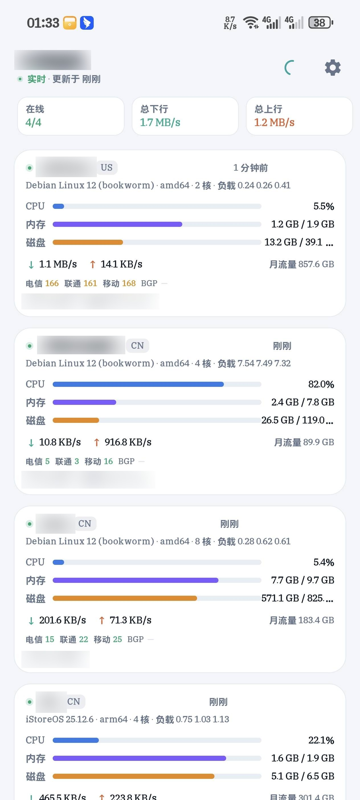

# CF 监控 · Android 客户端

基于 [huilang-me/CF-Server-Monitor](https://github.com/huilang-me/CF-Server-Monitor) 的**只读监控客户端**。

Kotlin + Jetpack Compose 原生实现，不套 WebView，直接对接 Worker 的 REST + WebSocket 接口：
服务器列表、实时指标、历史曲线、三网延迟、在线状态推送，全部走官方 API。

<p float="left">
  
</p>

> **下载 APK**：见下方 [下载安装](#下载安装-apk)。当前版本 **v1.0.6**（versionCode 7），
> 已在本机用 JDK 17 + AGP 8.7.3 + Kotlin 2.0.21 实测 `assembleDebug` 通过（0 error / 0 warning）。
> 界面预览也可用浏览器打开 `preview.html`。

---

<a id="下载安装-apk"></a>

## 〇、下载安装 APK

两种方式，都不需要本地装 Android Studio：

### 方式一：GitHub Actions 自动构建（每次 push 都会出包）

1. 打开本仓库的 **Actions** 页 → 选最新的 **Build APK** 运行
2. 在运行详情页底部 **Artifacts** 下载 `CFMonitor-debug-apk`
3. 解压得到 `CFMonitor-x.y.z-debug.apk`，传到手机安装即可

### 方式二：Releases（正式发版）

打 `v*` 标签（如 `v1.0.6`）时，Actions 会自动构建并把 APK 挂到 **Releases** 页面，直接下载附件安装。

> APK 为 debug 签名，仅供自用/内测；安装时如提示未知来源，允许一次即可。
> 覆盖安装要求包名与签名一致，直接装新版本即可升级数据不丢。

---

## 一、它是什么 / 不是什么

**是**：一个把自己部署的 CF-Server-Monitor 数据搬到手机上的看板。

**不是**：不是后台管理端。没有增删服务器、改配置、装探针、远程命令的能力 —— 服务器探针仍然用项目官方的 `cfsm-agent` 安装，
本 App 只读取 `api/*` 系列接口（外加登录换取 JWT）。

| 能力 | 说明 |
| --- | --- |
| 服务器列表 | 名称、分组、区域、在线状态、CPU / 内存 / 磁盘、实时上下行、月流量、负载、到期时间 |
| 实时推送 | `/api/ws` 的 `batchUpdate` 合并推送，前台常驻订阅 + 断线指数退避重连 |
| 详情页 | CPU / 内存 / 磁盘环形图、网络、磁盘 IO、进程与连接数、系统信息、GPU |
| 历史曲线 | 10 分钟 / 1 小时 / 6 小时 / 24 小时 / 7 天，CPU+内存、网络双线、三网延迟 |
| 三网延迟 | 电信 / 联通 / 移动 / BGP 当前值与丢包率，详情页带历史折线 |
| 鉴权 | 公开站点直连、`X-App-Password` 口令、管理员账号登录换 JWT 三种方式 |
| 兜底刷新 | 实时推送之外按 15 / 30 / 60 秒轮询一次列表，可关闭 |
| 外观 | 深色 / 浅色 / 跟随系统，深色为默认观感 |

---

## 二、怎么跑起来

### 1. 用 Android Studio 打开

```
File → Open → 选择本目录（CFServerMonitorAndroid）
```

首次打开会自动 Gradle Sync（需联网下载依赖）。

### 2. 环境要求

| 项目 | 版本 |
| --- | --- |
| Android Studio | Ladybug (2024.2) 及以上，**用自带 JDK** |
| JDK | 17（Android Studio 内置的 JBR 即可，不要用系统里的 JDK 8） |
| Gradle | 8.9（wrapper 已带） |
| AGP / Kotlin | 8.7.3 / 2.0.21 |
| compileSdk / minSdk | 35 / 24（Android 7.0 起） |

### 3. 运行 / 打包

- 连真机或开模拟器，点 ▶ Run。
- 打包 APK：`Build → Build Bundle(s) / APK(s) → Build APK(s)`，
  产物在 `app/build/outputs/apk/debug/`。
- 命令行：`./gradlew assembleDebug`（Windows 用 `gradlew.bat`）。

> 图标目前用的是矢量占位图标（`res/drawable/ic_launcher.xml`），
> 想要更好看的图标可以右键 `res` → New → Image Asset 自己生成一套。

---

## 三、连接你的站点

首次启动是引导页，填两样东西：

1. **Worker 地址**：`https://status.example.com`（填了 `/admin` 会自动去掉）
2. **App 访问口令**（推荐）：后台 → `安全设置 → App 访问口令` 生成一个 16-32 位口令

口令方式的好处（官方文档 §0.1-E）：

- 能读私有站点（`is_public !== 'true'`）
- 能看到被隐藏（`is_hidden=1`）的服务器
- 能拉取超过 24 小时的历史数据
- **绕过 Turnstile 人机验证**，不会被 Cloudflare 质询拦截
- 只读，不参与 `/admin/api` 管理鉴权，泄露风险远小于 API_SECRET

也可以点「改用管理员账号登录」，用后台账号密码换 JWT（有效期 7 天，过期会自动静默重登）。
站点如果是公开访问（`is_public=true`），两样都不填也能直接看。

> 站点开了 Turnstile 又没设 App 口令时，原生 App 无法完成人机验证，会提示 403 —— 去后台设个 App 访问口令即可。

---

## 四、项目结构

```
app/src/main/java/com/cfsm/monitor/
├── MainActivity.kt          # 入口，edge-to-edge
├── CfsmApp.kt               # 主题 + 页面路由 + 前后台生命周期
├── MonitorViewModel.kt      # 状态中枢：拉取、实时合并、历史、偏好
├── data/
│   ├── ApiClient.kt         # OkHttp：/api/config /api/servers /api/server /api/history/all /admin/api(login)
│   ├── RealtimeClient.kt    # /api/ws 订阅、batchUpdate 解析、重连
│   ├── Models.kt            # Server / SiteConfig / HistoryPoint + 容错解析
│   ├── Json.kt              # 数字/字符串/布尔/null 混合类型的容错取值
│   └── ConfigStore.kt       # SharedPreferences 存地址、口令、JWT、偏好
├── ui/
│   ├── HomeScreen.kt        # 列表 + 统计条 + 服务器卡片
│   ├── DetailScreen.kt      # 环形图、网络、磁盘 IO、延迟、历史图表、系统信息
│   ├── SetupScreen.kt       # 首次连接引导
│   ├── SettingsScreen.kt    # 连接信息、外观、刷新间隔
│   ├── Format.kt            # 字节/速率/时长/日期格式化
│   ├── components/Common.kt # 卡片、指标条、环形进度、状态点
│   ├── components/Charts.kt # 自绘折线图（Canvas，无第三方图表库）
│   └── theme/Theme.kt       # 深/浅色方案 + 指标专用色板
└── res/                     # 主题、图标
```

依赖只有 `okhttp` + AndroidX/Compose，没有图表库、没有 DI、没有 Room —— 减少版本冲突，
整个工程能直接 Sync 通过。

---

## 五、接口对照

| App 行为 | 接口 | 鉴权 |
| --- | --- | --- |
| 站点标题 / Ping 节点名 / 长历史点数 | `GET /api/config` | 无 |
| 服务器列表 + 统计 + 站点开关 | `GET /api/servers` | `X-App-Password` 或 JWT |
| 详情（探针版本、GPU、内核等） | `GET /api/server?id=` | 同上 |
| 历史曲线 | `GET /api/history/all?id=&hours=` | 同上（>24h 必须鉴权） |
| 实时指标 | `GET /api/ws?subscribe=all` | 同上（私有站点必须） |
| 管理员登录换 JWT | `POST /admin/api {action:login}` | 账号密码 |

`hours` 严格使用官方白名单值：`0.167 / 0.5 / 1 / 6 / 12 / 24 / 48 / 96 / 168`。

### 几个必须注意的实现细节

- **离线判定**：`last_updated` 超过 300 秒视为离线（与官方前端一致）。
- **WebSocket**：`subscribe=all` 默认不推任何数据，连上后必须发
  `{"type":"subscribe","scope":"all","ids":[...]}`，`ids` 取 `/api/servers` 的 `servers[].id`。
- **批量样本**：取每个 `updates[].samples` 的**最后一条** `data`，只有它带完整报告级字段（磁盘、GPU、进程、Ping 等）。
- **延迟字段**：`ping_ct` 可能是数字 / `null`（本轮超时）/ `false`（未配置）/ 缺失，四种都要分开处理，
  否则整页解析会崩。`data/Models.kt` 里统一用 `Latency?` 表达：`null` 不显示，`timeout=true` 显示「超时」。
- **单位**：`ram_*` / `disk_*` 是 MB，`net_*` 是字节，`net_*_speed` 是 B/s。

---

## 五.4、v1.0.6 更新：首页指标行布局打磨

1. 首页 CPU / 内存 / 磁盘三行指标条：进度条占满剩余宽度、右侧数值固定宽度右对齐，三行严格对齐。
2. 内存 / 磁盘容量改为同源单位紧凑写法（如 `132/392 GB`），窄屏下不再被截断。
3. 关于页版本号改读 `BuildConfig.VERSION_NAME`，UI 显示与实际包版本永远一致。

## 五.3、v1.0.5 更新：磁盘 IO 实时刷新（历史数据驱动）


磁盘 IO 属于**低频指标**：上游服务端的高频 WS 采样通常只带 CPU / 网速，磁盘 IO 只在报告级采样与历史表 `/api/history/all` 里才有（字段 `disk_read_bps` / `disk_write_bps` / `disk_read_iops` 等）。因此单纯靠 WS 快照，磁盘 IO 看起来「不跳」。参考项目 `chaos-zhu/cf_monitor_app` 正是用历史数据画磁盘 IO 曲线实现持续刷新的。v1.0.5 据此改造：

1. `HistoryPoint` 补上 6 个磁盘字段并从历史接口解析。
2. 详情页新增「磁盘 IO」吞吐曲线（读 / 写），随历史数据更新。
3. 磁盘 IO 数字卡片优先取历史最新采样点的值，无历史时回退快照。
4. 详情页每 10 秒自动刷新一次历史，让低频指标也持续跳动（与「自动刷新间隔」设置无关，离开详情页自动停止）。

## 五.2、v1.0.4 更新：磁盘 IO / 总上下行 / 部分服务器不刷新

对照上游服务端源码修复三个指标显示问题：

1. **详情页磁盘 IO 不刷新**：Agent 高频采样的 payload 里磁盘字段是扁平的 `disk_read_bps` / `disk_write_bps` / `disk_read_iops` 等（服务端 `DISK_IO_FIELD_TO_COLUMN` 映射），而 `parseServer` 原来只读嵌套 `disk:{read_bps}`。现在两种形式都兼容。
2. **首页总上下行不刷新**：总上下行取 `stats.speedIn/speedOut`，原本只在 REST 拉取时生成，WS 单机更新后从不重算。现在每次指标更新（WS patch 或 REST 回放）后都基于当前服务器列表实时重算在线数、总上下行、总流量。
3. **只有部分服务器刷新**：订阅签名从「数量」改为「内容」，服务器数量不变但 id 变化时也会补发订阅；每次 REST 刷新后无条件重发订阅，自愈 Durable Object 休眠/重启导致 `serverIds` 丢失的「假连接」。

## 五.1、v1.0.3 更新：找到「WS 连着却不跳」的真正根因（重要）

前两版修的都是连接层（UA、订阅、轮询兜底），但 WS 显示「已连接」时指标仍不动 —— 根因在**解析层的字段名**。

对照上游服务端 `src/handlers/update.js` 的 `toBroadcastSamples()` 与 `src/durable/MetricsBroadcaster.js` 的 `_broadcastBatch()` 后发现：

- Agent 上报的数据经 `toBroadcastSamples()` 生成，**每条采样点用的字段名是 `payload`**（前面高频点）或带完整指标的 `payload`（最后一条报告点）。
- 这批数据经 `_broadcastBatch()` **直接透传**给前端，字段名仍然是 `payload`，并不会变成 `data`。
- 参考项目 `chaos-zhu/cf_monitor_app` 的 `MetricSample.parse` 明确兼容 `data / payload / metrics` 三种：`raw['data'] ?? raw['payload'] ?? raw['metrics']`，所以它能正常跳动。
- 我们之前只取 `sample.optJSONObject("data")`，拿不到 `payload`，于是**每条采样都被 `?: continue` 丢弃**，samples 恒为空 —— WS 消息收到了，却永远不产生一次指标更新。REST 快照里的 `latestReportUpdates` 也是同样的 payload 格式，所以回放同样失效。

**修复**：`parseReportUpdates()` 改为依次兼容 `data / payload / metrics` 三种字段名，时间戳同时兼容 `ts / timestamp / sample_timestamp / last_updated / report_timestamp`。这是唯一能解释「连接正常、消息到达、但数值完全不动」的根因，改完 WS 推送与 REST 回放两条通道都会真正生效。

## 六、v1.0.2 更新：指标持续跳动（重要）

若站点 WebSocket 不推送（DO 未绑定 / 被代理拦截 / 假连接），v1.0.1 仍可能不跳。v1.0.2 改为不依赖 WS：

1. **REST 轮询成为可靠保底**：默认 5 秒拉一次（原 30 秒），首页和详情页都会持续更新；WS 只作为加速通道，断不断都照常轮询。
2. **轮询设为「关闭」时**：若 WS 未连接，仍每 15 秒兜底一次，不会彻底停住。
3. **解析 `latestReportUpdates`**：REST 快照附带的细粒度采样（cpu / 网速只在采样点上报，不进 `servers[]` 列），每次拉取后回放，指标更连续。
4. 设置页刷新选项改为 5 / 10 / 30 秒 / 关闭。

> 如果装了 v1.0.2 指标仍不跳，请到「设置 → 实时连接」看 WS 状态：显示「已连接」但指标不动＝服务端不推送（靠 5 秒轮询兜底应该仍会跳）；显示断开＝WS 被网络环境拦截，轮询同样能兜底。

## 六.1、v1.0.1 更新：实时指标修复

参考 `chaos-zhu/cf_monitor_app` 的实时方案，修复了「界面有但网速 / CPU 不刷新」的问题：

1. **WS 握手补上浏览器 User-Agent**：与 REST 请求一致，避免被 Cloudflare 识别为脚本连接而拦截 / 降级。
2. **合并一批内的全部采样**：上游 `batchUpdate` 里 cpu、内存、网速等高频字段分散在多条 sample 中，最后一条只额外带报告级字段。现在按时间顺序逐条合并，不再只取最后一条。
3. **按字段时间戳去重**：乱序或重复的 WS 帧不会再把网速 / CPU 打回旧值。
4. **订阅时序兜底**：`subscribe=all` 默认不推送，连上后先发带 id 的订阅；服务器列表晚到时补发订阅。
5. **断线自动降级**：WS 不可用（或用户把自动刷新设为 0）时，仍每 15 秒拉一次 REST，指标不会一直停在旧值。
6. 增加 25 秒应用层 ping 保活。

## 七、常见问题

| 现象 | 原因与处理 |
| --- | --- |
| 401 未授权 | 站点未公开。填 App 访问口令，或用管理员账号登录 |
| 403 人机验证 | 站点开了 Turnstile。去后台设 App 访问口令（可绕过），本 App 内置浏览器无法过验证码 |
| 409 databaseUpgradeRequired | 服务端数据库版本旧，登录后台点「数据库管理 → 升级数据库」 |
| 显示「离线」但网页正常 | 检查 Worker 的 `/api/ws` 是否绑定 Durable Object；或网络处于代理环境导致 WSS 被拦 |
| 历史为空 | 该时间段内探针没上报；或站点未鉴权，`hours>24` 被服务端拒绝 |
| 改完 API_SECRET 后连不上 | 后台登录密码可能已和 `API_SECRET` 分离，重新用新密码登录一次 |

---

## 八、隐私

- 所有请求只发往你自己填写的 Worker 域名，没有第三方统计、没有遥测。
- 连接信息（地址、App 口令、JWT、可选的账号密码）存在应用私有 SharedPreferences 里，卸载即清除。
- 卸载或点「断开连接并清除本地数据」会清空全部本地凭据。

## 九、许可

本项目以 [MIT License](LICENSE) 发布，可自由修改使用。上游 [CF-Server-Monitor](https://github.com/huilang-me/CF-Server-Monitor) 为 MIT License，
接口文档与字段定义版权归其作者所有。
